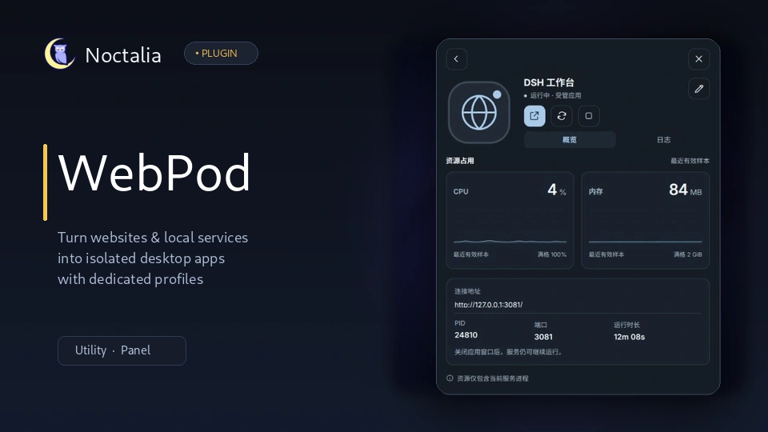

# WebPod

[](LICENSE)
[](https://noctalia.dev)
[](pyproject.toml)



把网站或本地 Web 服务放进独立的 Chromium 应用窗口。窗口使用 `--app=<URL>` 与每应用独立的 `--user-data-dir`，保留各自的登录会话。插件 ID 为 `moshe-233/webapp-pod`，版本 1.0.0，Noctalia plugin_api 23。

## 启动方式

普通网站填写名称和 URL 即可。需要启动本地服务时启用受管理应用，填写启动命令和工作目录，然后选择一种 URL 来源：

| 来源 | 填写内容 | 开窗时机 |
| --- | --- | --- |
| 固定 URL | 如 `http://127.0.0.1:8000/` | 本机地址等待 TCP 监听，随后开窗；其他地址直接开窗 |
| 日志 URL 正则 | 匹配完整 HTTP(S) URL 的 Python 正则 | 当前服务日志出现完整匹配行后立即开窗 |
| 提取脚本 | 接收日志、输出一行完整 URL 的命令 | 脚本输出带换行的完整 URL 后立即开窗 |

普通固定端口应用不需要正则。动态 token/key 应用选择日志正则，例如：

```text
(?P<url>http://127\.0\.0\.1:3081/\?token=[A-Za-z0-9_-]+)
```

取值优先级是命名组 `url`、第一个捕获组、整个匹配。界面可粘贴日志样本预览。stdout 和 stderr 都进入同一份服务日志，匹配前去除 ANSI 颜色；未换行的片段等待补齐。默认 URL 等待上限为 15 秒。插件不发送 HTTP 探活请求，取得 URL 或端口开始监听不等同于页面已渲染完成。

启动命令通过 `/bin/sh -c` 在指定目录运行，环境继承启动插件的进程并增加 `WEBAPP_NAME`。端口由命令本身指定，例如 `dsh --profile work --host 127.0.0.1 --port 3081 --no-open`；插件不分配端口、不注入 PORT，也不拼接 token 模板。命令应以前台方式运行，由插件创建独立进程组并把输出直接重定向到日志文件，不能自己后台化。需要无缓冲输出的 Python 服务可在命令中使用 `python -u`。

取得地址或发生错误后，启动工具立即退出。没有每应用常驻 Python supervisor。关闭应用窗口后服务继续运行，再次打开会复用同一服务与已取得的 URL；服务退出后下一次启动会换新日志并重新取 URL。URL 提取失败时保留服务和错误，修正配置后可再次打开，或停止服务。插件无法验证应用自己轮换的 token；此时重启服务以重新提取。固定本机 URL 已有监听时可复用外部服务，停止只关闭本插件窗口，不终止该外部服务。

高级脚本以 stdin 接收完整日志行，stdout 只需输出一行完整 URL 并 flush；不使用 JSON。stderr 写入 `extractor.log`。脚本应保持前台，不派生脱离进程组的后台任务；成功、超时或失败后插件回收提取脚本进程组。脚本执行目录与服务一致。

## 界面

```sh
noctalia msg panel-toggle moshe-233/webapp-pod:panel
```

480×600 原生面板分为应用列表、新建、单应用详情和配置四个视图。首页显示活动服务数、平均 CPU 和服务内存；名称搜索按字面子串匹配，支持中文与 ASCII 大小写不敏感，搜索不会调用 CLI，也不会改变概览的统计范围。缺少桌面入口的受管服务仍保留在列表中。

- 点击受管应用名称进入详情。左侧预览已安装的本地图标，右侧依次为名称与状态、打开/重启/停止图标按钮、概览/日志页签。资源数值保留实际值，曲线满格分别为 100% CPU 和 2 GiB 内存；缺测显示“—”。
- 日志页只有一个滚动区，占据顶部信息下方的剩余空间。“重试”位于日志标题右侧。仅在当前日志页可见时读取末尾最多 16000 字节。运行中后台刷新保留当前内容；服务停止后补读一次末尾输出，随后停止自动读取，仍可手动重试。读取失败与空日志分别显示，切页或关闭后的旧结果不会覆盖当前应用。关闭面板不会停止服务，重新打开也不会清除仍在执行的操作互锁。
- 顶部“新建应用”进入独立创建表单。复杂字段在表单内滚动，底部返回/创建按钮固定；浏览器参数与图标默认折叠。返回列表后再进入可继续本次会话的草稿。创建只安装配置与入口，不启动应用。同名创建仍保留覆盖原配置与桌面入口的既有行为。
- 点击详情名称旁的铅笔直接编辑配置，普通网站从列表的铅笔进入。名称和类型只读，字段从原配置读取，草稿与新建表单独立。保存不启动或重启服务；服务字段需要下次启动生效，浏览器参数在下次开窗读取。外部修改导致 revision 冲突时保留草稿，需手动重新载入。
- 旧网站没有结构化 URL/参数记录时，需要补录 URL，并明确确认已填参数或使用默认参数；不会从旧 Exec 猜测。替换图标留空会保持现有图标。
- 移除入口仅在配置页底部默认折叠的“危险操作”里。先显示目标和影响，再次确认才执行。取消移除保留配置草稿；有业务操作或保存正在执行时不能移除。

桌面小组件继续展示运行服务数和资源概况；启动器输入 `/wa ` 可按名称找到受管理应用。

Noctalia 每两秒运行一次短命批量 `status`，读取 `ss` 的监听端口/PID，再从 `/proc` 读取对应服务进程的 CPU ticks 和 RSS。CPU 差分和最多 60 个历史样本放在 Noctalia 内存中；首次采样或查询失败显示未知，下一次有效采样恢复。指标针对识别到的服务进程，不表示整个 Chromium 或服务子进程树的总消耗。状态描述服务是否存活，不额外维护窗口关闭状态。

## 环境与安装

需要 Chromium 家族浏览器、系统 Python >=3.9、uv、Bash、iproute2 的 `ss`，以及 manifest 声明的常用系统命令。仅 Python 标准库，无第三方 Python 包。默认浏览器属于 Chromium 家族时优先使用，否则选择已安装的 Chromium/Chrome/Brave/Vivaldi/Edge。

在面板新建或预览前会等待安装准备完成。命令行也可运行：

```sh
bash scripts/webapp-setup.sh
```

setup 把脚本复制到 `~/.local/share/webapp-maker/`，通过系统 uv 离线、锁定模式创建 `runtime/.venv`；环境签名未变则跳过同步。日常点击直接执行该环境里的 Python，不运行 uv、不下载或安装依赖。源码测试环境单独准备：

```sh
uv sync --locked --offline --no-python-downloads --python /usr/bin/python3
bash tests/run-tests.sh
```

命令行安装例子：

```sh
~/.local/share/webapp-maker/webapp-install.sh \
  --runner "$HOME/.local/share/webapp-maker/webapp-run" \
  --start-cmd 'python3 -m http.server 8000' \
  --cwd "$HOME" --url-source fixed \
  'Local Server' 'http://127.0.0.1:8000/' web-browser
```

日志正则模式改用 `--url-source regex --url-regex PATTERN`，位置 URL 可以为空字符串；高级模式用 `--url-source script --extract-script COMMAND`。其他参数为 `--url-timeout SECONDS`、`--auto-open=false` 和 `--flags STRING`。Chromium flags 支持 shell 引号，但不能覆盖 `--app`、`--app-id` 或 `--user-data-dir`。普通网站使用 `--launcher "$HOME/.local/share/webapp-maker/webapp-launch"`，不传启动命令。未指定图标的普通网站尝试下载站点图标；受管理应用默认使用通用主题图标。

运行命令：

```sh
~/.local/share/webapp-maker/webapp-run launch 'Local Server'
~/.local/share/webapp-maker/webapp-run status
~/.local/share/webapp-maker/webapp-run stop 'Local Server'
```

`open NAME` 与 `launch NAME` 相同；`start CONF` 用指定配置启动并遵守 auto_open。`validate CONF` 仅验证配置；`match --regex PATTERN --line TEXT` 返回 `{ "url": ... }` 供正则预览。旧 `webapp-supervisor` 文件名只保留 exec 兼容入口。

配置编辑 CLI 为 `webapp-run config-read NAME` 与 `webapp-run config-write NAME --revision REV --json REQUEST`。请求包含完整 `fields`、可选 `icon_ref`；旧网站补录另需 `recovery_confirmed=true`。失败以非零退出码和结构化 code/message 返回；保存不修改运行记录或独立浏览器 profile。

## 文件与迁移

- 应用配置：`~/.local/share/webapp-maker/apps/<safe>.conf`，每行 `key = "value"`，双引号内部按字面保存正则和 shell 命令。
- 网站原始记录：`~/.local/share/webapp-maker/entries/<safe>.json`，记录网站 URL 和浏览器参数，不加入受管服务配置目录；成功移除时一起清理。
- 桌面入口：`~/.local/share/applications/<Name>.desktop`，指向稳定 launcher；独立浏览器 profile 位于 `~/.local/share/webapp-maker/profiles/<safe>/`。
- 启动记录：`~/.local/state/webapp-maker/<safe>/run.json`，只在启动、地址、错误或停止时更新，包含 PID 启动标识以避免误用回收的 PID。
- 服务日志：同目录 `app.log`，下一次创建服务时把上一轮换为 `app.previous.log`；高级提取错误在 `extractor.log`。日志可能含应用自身打印的 token，应按凭证文件管理。
- 停止先 TERM 本插件拥有的服务进程组和独立 profile 窗口，默认等待三秒再 KILL 剩余进程并清理 Singleton 锁。移除在停止失败时保留配置、profile、记录和桌面入口，报告实际错误。

2.x 的端口分配、token/port 单项正则、URL 模板、JSON 提取协议和 HTTP probe 配置不能直接用于 3.x，需要明确改成固定 URL 或完整 URL 提取。旧 daemon/HTTP 特定测试在本次开发工作区归档；新测试覆盖 URL、复用、并发、错误清理、PWA 参数、安装移除及 UI 异步拒绝。`tests/run-tests.sh` 包含真实隔离服务与浏览器 stub、离线 UI 模拟和 Noctalia lint；真实窗口验证需要实际桌面会话。

`env_file` 设置仍在创建操作前 source，用于图标请求代理等环境；日常启动环境由桌面会话及自定义启动命令决定。

配置保存使用同一应用的非阻塞互锁、源文件 revision 和同目录临时替换。多文件保存保留 `~/.local/state/webapp-maker/<safe>/config-edit.pending/` 恢复记录。若中断或回滚失败，后续编辑、安装和移除会停止并提示人工恢复；应先按其中 manifest 与备份核对原文件，不能直接删除记录后覆盖。此版本没有自动恢复命令。

## 开发与测试

本项目自带完整的单元测试、安装/移除验证及离线 UI 模拟检查。

### 准备环境

```sh
# 使用 uv 在锁定模式下准备本地开发与测试环境
uv sync --locked --offline --no-python-downloads --python /usr/bin/python3
```

### 运行测试

```sh
# 运行完整测试套件（含语法、安装、运行器与离线 UI mock）
bash tests/run-tests.sh

# 单独执行指定检查
.venv/bin/python -B tests/test-config.py
.venv/bin/python -B tests/test-install.py
.venv/bin/python -B tests/test-light-launcher.py
.venv/bin/python -B tests/check-ui.py

# 插件规范与元数据检查
noctalia plugins lint .
```

> **说明**：测试套件运行在沙箱临时目录（使用模拟 HOME、可控的临时服务进程及浏览器 stub），不会修改当前用户的生产配置或桌面项。

## 注意事项与已知局限

- **宿主挂载动画**：按钮初次挂载时可能出现短暂背景闪黑，该现象源于 Noctalia 宿主当前的初始化动画机制（参考上游 PR #5012）；插件内部已优化页签切换逻辑以减少不必要的按钮重建。
- **浏览器兼容性**：优先适配并调用 Chromium 系列浏览器（Chrome / Chromium / Brave / Vivaldi / Edge）以提供独立的 `--app` 与 `--user-data-dir` 支持。
- **图标回退**：若应用指定的本地图标缺失或系统主题名无法解析，面板将自动回退到通用矢量图标。
- **监控指标**：面板与小组件展示的 CPU 与内存指标基于已识别的服务进程自身及其直接子进程资源，不包含独立运行的 Chromium 浏览器窗口消耗。

## 致谢与许可证 (Credits & License)

- 本项目基于 [umedbazarov](https://github.com/umedbazarov) 的 Webapp Maker 进行分支开发，并参考了 Omarchy 的 `omarchy-webapp-install` 方案。
- 由 [moshe-233](https://github.com/moshe-233) 进行了彻底重构与长期维护。
- 项目采用 [MIT License](LICENSE) 许可协议开源。
